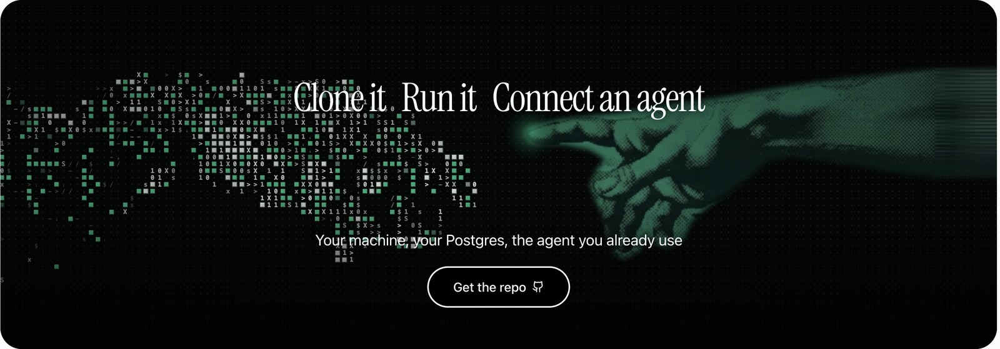

[](#quick-start)

# Team-Ops

**The self-hosted engineering board for humans and AI agents.**

People drag cards. Coding agents update the same board through MCP. Your team
can follow progress, understand blockers and see what has reached production,
without copying updates out of a chat.

MIT licensed · Your PostgreSQL · Go API · Next.js · MCP with OAuth

[Quick start](#quick-start) · [Connect your agent](#connect-your-agent) ·
[Vercel + Supabase](docs/deployment/vercel-supabase.md) · [Documentation](#documentation)

## What you get

- **One shared board:** Backlog → In Progress → Review → Done → Production,
  plus a dedicated **Blocked** column. Dropping a card into Blocked asks for
  the reason; moving it out resolves the blocker.
- **Visible blockers:** a Pending items page lists the reason and assignee.
  Administrators see a counter in the app, refreshed every 30 seconds.
- **Evidence of delivery:** finished tasks keep a PR, commit, deploy or other
  link. Work without a link, such as planning, can be explicitly marked as such.
  Done and Production remain distinct; both count as completed work.
- **People and timelines:** assigned work, activity history and contribution
  charts, including work performed by a person's coding agents.
- **Reports:** completed/created work, AI contributions, cycle time, blockers,
  overdue tasks, weekly charts, breakdowns by person/project and CSV exports.
- **Agents on the team:** connect Claude Code, Cursor or VS Code through MCP
  and browser sign-in. The bundled skill guides task creation, progress,
  blockers, reviews and completion.
- **English, Portuguese and Spanish**, with light and dark themes.

The Go API owns permissions and business rules. People and agents use the same
rules, including version checks that prevent silent overwrites. There is no
required Team-Ops cloud account. Your chosen AI provider may still receive
context from your coding agent.

## Quick start

Requires **Git** and **Docker with Compose**. Start from the repository:

```bash
git clone https://github.com/IgorPierre/team-ops.git
cd team-ops
cp .env.example .env
# Set POSTGRES_PASSWORD in .env before starting.
docker compose up -d --build
```

Open **http://localhost:3000/register** and create the first account. It
bootstraps the instance. With the default `REGISTRATION_OPEN=false`, later
members join through invitations from **People**. Administrators manage the
team; developers update work; viewers follow along.

### Optional interactive installer

Create an instance with the public npm installer:

```bash
npm create team-ops@latest my-team
```

The terminal asks whether to include **AI agents** and the **landing page**, which
Postgres to use, the public URL and who can register. The board and API are
always included. The installer can install dependencies, initialize Git and,
when Docker is available, start the stack with optional demo data.

```bash
# Board + agents, without the marketing landing page
npm create team-ops@latest my-team -- --no-website

# Include the landing page
npm create team-ops@latest my-team -- --website
```

The landing page lives in `apps/website`; it is separate from the board in
`apps/web`. Selecting it includes its source, not an automatic public deploy.
Run `npx create-team-ops@latest --help` for all options. The installer needs
Node.js 20+; Docker is needed to start its container stack.

## Connect your agent

Each developer connects to the instance using their own Team-Ops account.
Open **Agents** in the app for editor-specific instructions. The MCP URL is
`https://YOUR-TEAM-OPS/mcp`.

For Claude Code:

```bash
claude mcp add --transport http team-ops https://YOUR-TEAM-OPS/mcp
# In Claude Code: /mcp → team-ops → Authenticate → Allow
```

For the skill and project configuration, run this inside the repository where
you do your coding:

```bash
npx @team-ops/setup@latest --url https://YOUR-TEAM-OPS
```

The setup CLI writes the editor's MCP configuration, installs the
[Team-Ops skill](skills/team-ops/SKILL.md) and links the repository using
`.team-ops.json`. Restart the editor and sign in. The generated configuration
contains no credentials and can be committed for teammates to reuse.

The skill guides the agent to open or pick up a card, update its checklist,
report meaningful progress, explain blockers and finish with a summary and
evidence. Tasks created by an agent are assigned to its developer. Production
is for finished work that has actually been deployed. Set `autoUpdate: false`
in `.team-ops.json` to update the board only when asked.

The hosted MCP also supplies workflow instructions. You can connect it before
installing the skill. **Agents** shows connected editors and lets an owner or
administrator disconnect them. Scripts and CI can use `@team-ops/mcp` over
stdio with an API key; see the [MCP guide](docs/mcp/README.md).

## Deploy your own instance

Choose either deployment path:

- **Docker on a server:** deploy the API and web containers, configure HTTPS
  and your database. Follow the [deployment guide](docs/deployment/README.md).
- **Vercel + Supabase:** create two Vercel projects — `apps/web` for Next.js
  and `apps/api` for Go — and use Supabase as PostgreSQL. Follow the
  [step-by-step guide](docs/deployment/vercel-supabase.md) for environment
  variables, database access, migrations and the first administrator account.
  The optional landing page is a separate `apps/website` Vercel project.

Supabase is the database host; Team-Ops continues to own authentication and
permissions. No Supabase browser keys are needed. Run schema migrations before
serverless deployments and keep demo data out of production.

For another PostgreSQL 15+ host (Neon, RDS, Cloud SQL, Railway, etc.), see
[external PostgreSQL](docs/deployment/external-postgres.md).

## Try demo data locally

```bash
make docker-seed  # running Docker stack
# Or: make db-seed — local development API, requires Go and DATABASE_URL
```

Sign in with **alex@example.com / password123** and select **Northwind Labs →
ERP**. The standard seed includes projects, people, tasks, comments and blockers.
Do not run it against a production database.

## Documentation

- [Getting started](docs/getting-started/README.md)
- [Architecture](docs/architecture/README.md)
- [HTTP API](docs/api/README.md) and [OpenAPI specification](openapi/openapi.yaml)
- [MCP and agent setup](docs/mcp/README.md)
- [Deployment](docs/deployment/README.md)
- [Vercel + Supabase](docs/deployment/vercel-supabase.md)
- [Security](docs/security/README.md)
- [Publishing npm packages](docs/publishing/README.md) — maintainers
- [Contributing](CONTRIBUTING.md)

## Development checks

```bash
npm ci
npm test
npm run typecheck
npm run lint
```

Run API tests against a migrated test database, not your production database:

```bash
cd apps/api
# Set TEST_DATABASE_URL securely in your shell.
go test ./...
```

API integration tests are skipped when no database URL is configured. For the
Docker-based end-to-end check, run `make smoke-test`.

## License

[MIT](LICENSE)
